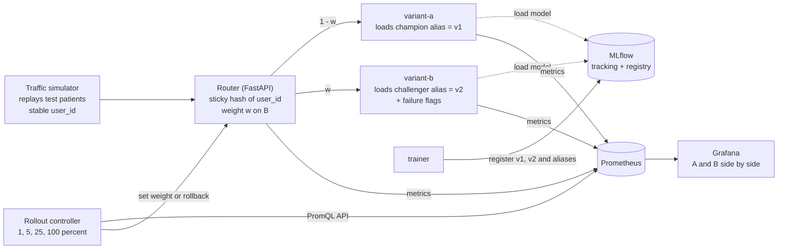

# P1 — Canary: safe rollout of a new readmission model (UCI Diabetes)

MLOps project, ESIB, Fall 2026 · Team: Hovig Majarian, Rayan Salman, Wassim Mouawad.

**Story.** v1 (logistic regression) predicts 30-day hospital readmission in production.
v2 (gradient boosting) is better offline but heavier. It must replace v1 **without breaking
the service**. A rollout controller moves 1% → 5% → 25% → 100% of users to v2, checks four
guardrails at every step from Prometheus, and rolls back automatically if one of them fails.

> Report: [`report/REPORT.md`](report/REPORT.md) · Slides: [`report/slides.pptx`](report/slides.pptx) ·
> Demo script: [`docs/DEMO_SCRIPT.md`](docs/DEMO_SCRIPT.md) · Likely questions: [`docs/QA.md`](docs/QA.md)

## Results at a glance

| Scenario (flag on v2) | Outcome | Caught by | When |
|---|---|---|---|
| healthy | **passed**, v2 at 100% (2 runs) | — | ~7 min |
| `B_EXTRA_LATENCY_MS=50` | **rolled back** | latency_p99 (88 ms > 52 ms limit) | 1% traffic, 314 v2 requests |
| `B_ERROR_RATE=0.05` | **rolled back** | error_rate (z = 10.0) | 1% traffic, 65 v2 requests, 46 s |
| `B_SCHEMA_BUG=1` (HTTP 200) | **rolled back** | score_psi (0.187 > 0.15) | 5% traffic, 546 v2 requests (957 in total) |

## Architecture



Every service runs in Docker Compose on a laptop CPU. Both variants run **the same image** and
differ only by environment variables (`MODEL_ALIAS=champion|challenger`, failure flags).
Every application metric (router, variants, controller) carries a `variant` label.

| Service | Port | Role |
|---|---|---|
| router | 8000 | entry point, sticky A/B assignment, end-to-end latency and errors |
| variant-a / variant-b | internal 8080 | model inference, score histogram |
| controller | 8090 | rollout loop, guardrails, rollback |
| mlflow | 5000 | experiment tracking and model registry |
| prometheus | 9090 | metrics store (scrape every 2 s) |
| grafana | 3000 | dashboard "P1 - Canary rollout" (no login) |
| simulator | — | replays the test split at `SIM_RATE` req/s (default 150) |

Each variant runs 8 uvicorn worker processes (Prometheus multiprocess mode adds up their metrics).

## Run it

Requirements: Docker Desktop. The scenario and screenshot scripts are for Windows (PowerShell,
Edge); on macOS/Linux run them with PowerShell 7 (`pwsh scripts/scenario.ps1 healthy`) or call the
controller API directly.

```powershell
docker compose up -d --build        # first build downloads ~200 MB of Python packages, then the
                                    # trainer downloads the data and trains both models
```

Open Grafana at <http://localhost:3000>, MLflow at <http://localhost:5000>.

Run a scenario (each stops a running rollout, recreates variant-b with a failure flag, then
starts a rollout). Use the `.cmd` launcher: it works whatever the PowerShell execution policy is.

```powershell
.\scripts\scenario.cmd healthy   # expected: PASSED, v2 at 100%
.\scripts\scenario.cmd latency   # +50 ms on v2      -> rolled back by latency_p99
.\scripts\scenario.cmd errors    # 5% HTTP 500 on v2 -> rolled back by error_rate
.\scripts\scenario.cmd schema    # silent schema bug -> rolled back by score_psi
```

Controller API: `POST /rollout/start` (optional JSON body overriding any setting, e.g.
`{"latency_allow_offline_overhead": false}`), `POST /rollout/abort`, `GET /rollout/status`.
Every rollout writes its full decision log to `data/rollouts/rollout-<time>.jsonl`; the logs of
the runs used in the report are kept in `report/evidence/`.

Report figures and analyses (run inside the stack; results land in `data/report_figures/`):

```powershell
docker compose run --rm trainer python -m analysis.offline_models
docker compose run --rm trainer python -m analysis.plot_rollouts
docker compose run --rm trainer python -m analysis.q1_sample_size
docker compose run --rm trainer python -m analysis.psi_calibration
docker compose run --rm trainer python -m analysis.q2_false_alarms
docker compose run --rm trainer pytest -q tests
```

Stop everything: `docker compose down` (add `-v` to also delete MLflow and Prometheus data).

## Data and models

* **Data**: UCI Diabetes 130-US hospitals (UCI #296), 101,766 encounters. Encounters ending in
  death or hospice are removed (they cannot be readmitted): 99,343 remain.
* **Target**: `readmitted == "<30"` (binary, 11.4% positive).
* **Split**: by `patient_nbr` (each patient appears in one split only), 70/15/15, seed 42:
  69,623 / 14,887 / 14,833 encounters. The test split is the traffic the simulator replays.
* **v1**: logistic regression (one-hot categories, scaled numerics) → `@champion`.
  Validation AUC 0.663, test AUC 0.653, ~1 ms per prediction.
* **v2**: `HistGradientBoostingClassifier` (native categories) → `@challenger`.
  Validation AUC 0.676, test AUC 0.663, ~10 ms per prediction (heavier).
* Both pipelines start with a small custom encoder (`p1.features.TabularEncoder`): it takes the raw
  request, so the MLflow model carries its own preprocessing, and it serves one row in < 1 ms.
* Each model version stores `reference.json` (validation score histogram, latency benchmark) and
  tags (`val_auc`, `offline_psi_vs_champion`, `offline_latency_overhead_ms`, `canary_result`).

## Guardrails

Checked every 5 s. v2's traffic since the step started is compared with v1's traffic since the
rollout started. Every threshold below is a controller setting: an environment variable of the
controller container, or a JSON override when a rollout is started.

| Guardrail | Rule (shipped settings) | Catches |
|---|---|---|
| error_rate | one-sided two-proportion **z-test**, p < 0.001 **and** gap ≥ 1 point, confirmed by an exact binomial test (from 50 v2 requests) | random HTTP 500s |
| latency_p99 | p99(v2) ≤ 1.1 × (p99(v1) + 1.5 × v2's offline extra cost), end to end (from 300 v2 requests) | extra latency |
| score_psi | PSI(v2 scores vs v1 scores) ≤ 0.15, from the 5% step and 500 v2 requests | silent schema bug |
| invalid_scores | share of NaN / out-of-range scores ≤ 0.1% | broken model output |

A guardrail must fail on **2 consecutive checks** to trigger a rollback. Rollback sets the
router weight to 0; the registry aliases are never changed. Each step lasts at least 30 s and
until v2 has served 400 / 700 / 1,000 / 1,500 requests.

**Deviations from the literal subject, and why** (details and evidence in the report):

* *Latency.* The subject's rule is p99(v2) ≤ 1.1 × p99(v1). v2 is heavier by design (~30 ms vs
  ~6 ms p99), so the literal rule rolls back a healthy v2 every time (Q2 simulation: 100%). The
  limit therefore adds v2's extra cost, measured offline and stored on the model version
  (`offline_latency_overhead_ms`). The literal rule is one setting away: start a rollout with
  `{"latency_allow_offline_overhead": false}`; we ran it, and a healthy v2 was rolled back at 1%
  after 308 requests (p99 32 ms > limit 8.1 ms).
* *Error rate.* The z-test is computed as required; because errors are rare (0.2%) and v2 sees few
  requests at 1%, an exact binomial test must agree before a breach (`{"exact_confirm": false}`
  disables it).
* *PSI.* At 1% traffic v2 serves only ~100 patients and PSI cannot separate a healthy v2 from a
  buggy one (simulated false-alarm rate 67%), so it is evaluated from 5% traffic.
* *Simulated background errors.* Both variants fail 0.2% of requests (`BASE_ERROR_RATE`), like a
  flaky dependency in production; without it v1 has zero errors and the z-test is degenerate.

## Repository layout

```
src/p1/          features + encoder, data split, training, model service, router, simulator,
                 controller, statistics, Prometheus client
analysis/        report analyses (offline models, rollout timelines, Q1, PSI calibration, Q2)
monitoring/      Prometheus config, Grafana provisioning and dashboard
scripts/         scenario runner (+ .cmd launcher), dashboard generator, Grafana screenshots
tests/           unit tests (statistics, sticky routing, silent schema bug)
report/          report (MD, PDF), slides, figures, evidence (decision logs of every run)
docs/            demo script and Q&A
```
