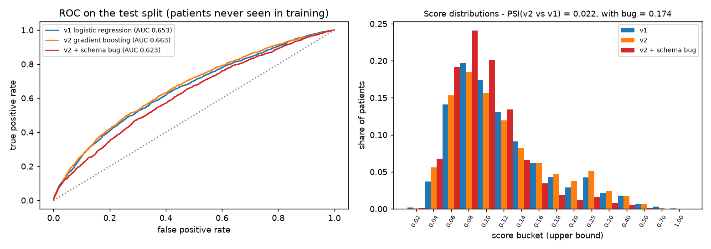
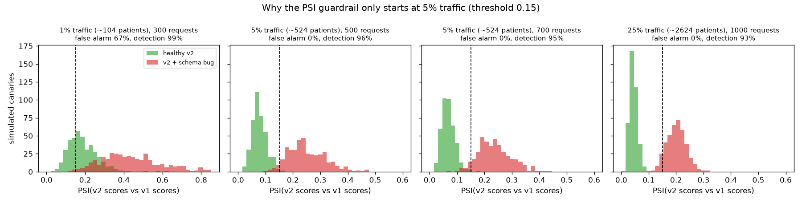
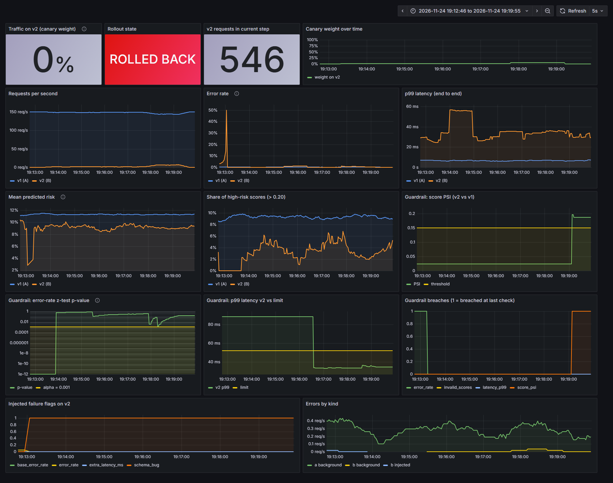
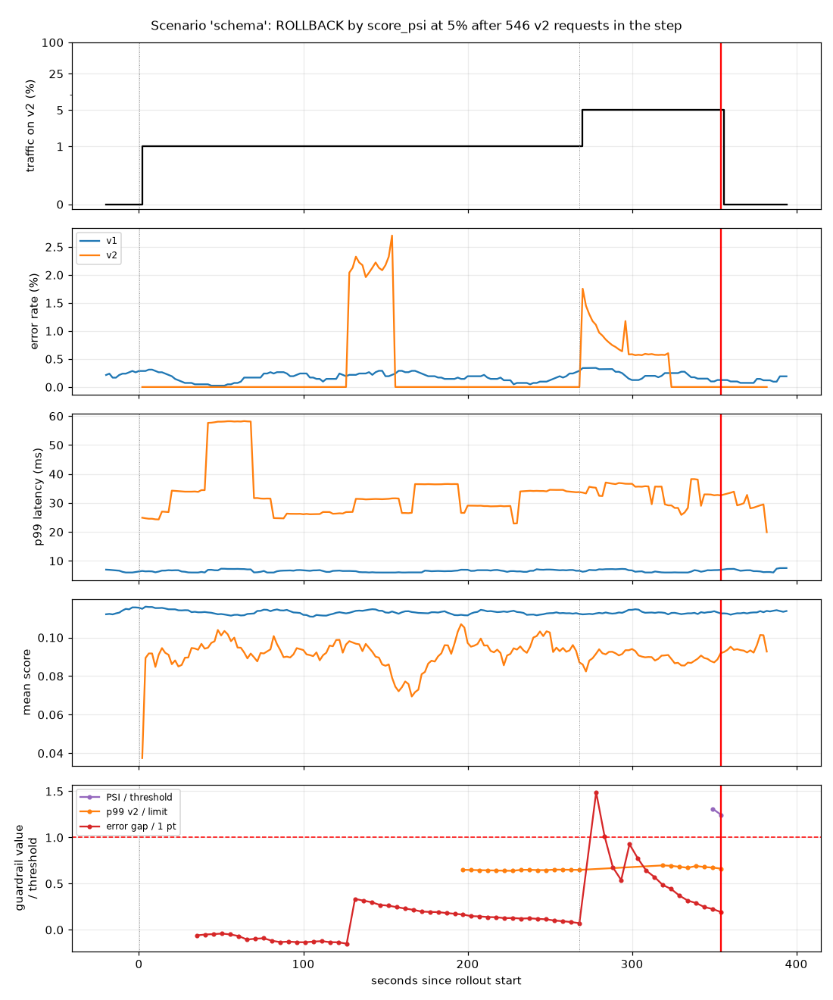
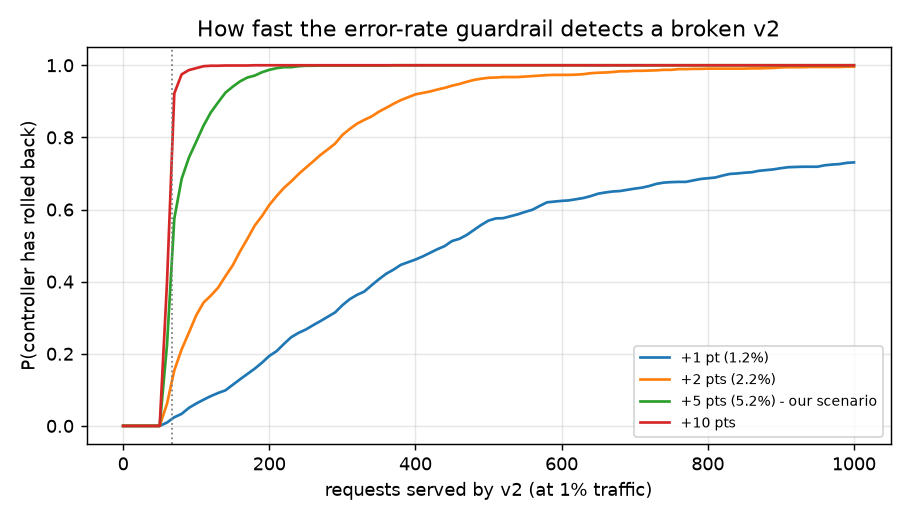
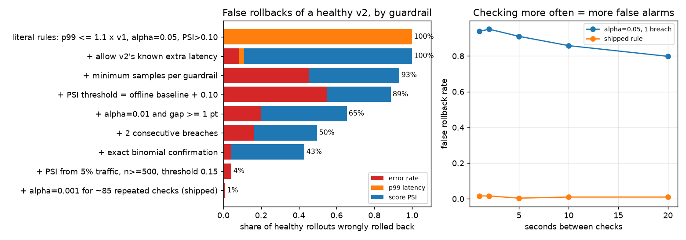

# P1 — Canary: safe rollout of a new readmission model

**MLOps, ESIB, Fall 2026** · **Team:** Hovig Majarian, Rayan Salman, Wassim Mouawad

Dataset: UCI Diabetes 130-US hospitals · Repository: this folder

## 1. Goal and decision

v1 (logistic regression) predicts whether a diabetic patient will be readmitted within 30 days.
v2 (gradient boosting) is better offline but about ten times heavier. We built a canary release
that moves patients to v2 in four steps (1% → 5% → 25% → 100%), checks four guardrails from
Prometheus every 5 seconds, and rolls back automatically.

**Decision.** With a healthy v2 the rollout **passed** all four steps twice (≈ 7 minutes each) and v2
served 100% of traffic. Each injected failure was **rolled back by the guardrail designed for it**,
at 1% or 5% traffic. The canary shows v2 is **safe** to serve; it does not show v2 is **better**
(question 3), so `@champion` stays on v1 until a human promotes v2 after an A/B test. Every
rollout writes its result on the model version as the tag `canary_result` (`passed` after a healthy
run, `rolled_back: <guardrail>` otherwise).

| Scenario (flag on v2) | Outcome | Guardrail and value | Traffic, v2 requests, time |
|---|---|---|---|
| healthy (2 runs) | passed, 100% on v2 | all within limits | 441 s and 438 s |
| +50 ms latency | rolled back | p99 = 88 ms > limit 52 ms | 1%, 314 requests, 203 s |
| 5% HTTP 500 | rolled back | error gap 6.0 pts, z = 10.0, exact p = 6·10⁻⁶ | 1%, 65 requests, 46 s |
| silent schema bug (HTTP 200) | rolled back | PSI = 0.187 > 0.15 | 5%, 546 requests, 354 s |

## 2. System

All services run in Docker Compose on a laptop CPU (README for the diagram and commands).

* **Router** (FastAPI, ours): sends user `u` to v2 when (first 32 bits of `sha256(u)`) mod 10,000 < weight × 10,000.
  Assignment is sticky and monotonic: when the weight grows, users already on v2 stay there.
  It measures what users see: end-to-end latency and errors.
* **variant-a / variant-b**: the same image; they load `models:/readmission@champion` and
  `@challenger` from the MLflow registry. Failure flags: `EXTRA_LATENCY_MS`, `ERROR_RATE`,
  `SCHEMA_BUG`. 8 worker processes each.
* **Simulator**: replays the test split (patients never seen in training) at 150 requests/s, with
  `patient_nbr` as a stable user id.
* **Prometheus** scrapes every 2 s; **Grafana** shows A and B side by side. Every application metric
  (router, variants, controller) has a `variant` label.
* **Controller**: a Python loop that sets the router weight, queries the Prometheus HTTP API (exact
  counter differences between the step start and now) and writes a JSON log of every check.

**Data and models.** Encounters ending in death or hospice are removed (they cannot be readmitted).
Split by `patient_nbr`, 70/15/15, seed 42: 69,623 / 14,887 / 14,833 encounters, 11.4% positives.

| | v1 logistic regression | v2 gradient boosting |
|---|---|---|
| Validation AUC | 0.663 | **0.676** |
| Test AUC | 0.653 | **0.663** |
| Recall in top 15% (val) | 0.300 | 0.313 |
| One prediction, p50 / p99 | 0.9 / 2.4 ms | 10.3 / 29.5 ms |

## 3. Guardrails and why they look like this

| Guardrail | Rule | Minimum v2 requests |
|---|---|---|
| error_rate | one-sided two-proportion z-test p < 0.001, gap ≥ 1 point, exact binomial test agrees | 50 |
| latency_p99 | p99(v2) ≤ 1.1 × (p99(v1) + 1.5 × 27.1 ms), ignoring the first 10 s after each weight change | 300 |
| score_psi | PSI(v2 scores, v1 scores) ≤ 0.15, from 5% traffic | 500 |
| invalid_scores | NaN / out-of-range share ≤ 0.1% | 20 |

A breach must appear on **two consecutive checks**. Rollback = router weight 0; aliases unchanged.
Both variants have a simulated background error rate of 0.2% (a flaky dependency); without it v1
has zero errors and the z-test has nothing to compare against.

Three choices go beyond the literal subject. They were forced by measurements and by **real false
rollbacks of a healthy v2** while tuning: 5 of our first 6 healthy runs were rolled back (error rate
at 1%, PSI at 1%, latency at 1%, 25% and 100%; logs in `report/evidence/rollouts/tuning/`):

1. **Latency allowance.** v2's p99 is ~30 ms against ~6 ms for v1 *by design*. The literal rule
   p99(v2) ≤ 1.1 × p99(v1) ≈ 7 ms rolls back every healthy v2 (100% in simulation). The extra cost
   v2 was accepted for (27.1 ms, measured offline and stored as a tag on the model version) is added,
   with a 1.5 headroom because the idle offline benchmark under-estimates load (live p99 reached
   ~42 ms at 25% and 46 ms at 100% traffic). Limit ≈ 52 ms. Cost: a slowdown that keeps v2's p99
   under ~52 ms (+6 to +20 ms on top of its normal 30–46 ms) is not caught.
   The literal rule remains available: start a rollout with `{"latency_allow_offline_overhead": false}`.
   Live check: with it, a healthy v2 was rolled back at 1% traffic after 308 requests (p99 32 ms >
   limit 8.1 ms; log in `report/evidence/rollouts/literal_latency_rule/`).
2. **Exact confirmation of the z-test.** One background error in 58 v2 requests gave a "significant"
   z-test (p < 0.01) and rolled back a healthy v2: the normal approximation fails with rare events
   and small samples. The exact binomial probability of that event is 11%. We keep the z-test and
   require the exact test to agree. The same noise later made the *error* guardrail roll back a
   schema-bug run at 1% before PSI could look; together with the ~85 checks per rollout, this is
   why α was lowered to 0.001.
3. **PSI from 5% traffic.** See below.

**Why PSI starts at 5% and the threshold is 0.15.** At 1% traffic v2 serves only ~100 patients, so
its score distribution differs from v1's because the *patients* differ. Simulating thousands of
random patient subsets:

| Traffic, v2 requests | Healthy PSI p99 | Schema-bug PSI p5 | False alarms at 0.15 | Detection at 0.15 |
|---|---|---|---|---|
| 1%, 300 | 0.40 | 0.21 | **67%** | 99% |
| 5%, 500 | 0.14 | 0.16 | 0.5% | 96% |
| 25%, 1,000 | 0.08 | 0.15 | 0% | 93% |

## 4. The three injected failures

**Latency (+50 ms).** p99 of v2 jumped to 88 ms while the limit was 52 ms; rolled back at 1% after
314 v2 requests. **Errors (5% HTTP 500).** Rolled back at 1% after 65 v2 requests (46 s): only
about 65 patient requests were exposed. **Silent schema bug.** `number_inpatient` (past inpatient
visits, the strongest predictor) is renamed upstream; the service imputes the missing column and
answers HTTP 200. The error and latency guardrails never breach (at the start of the 5% step one
background error in 60 requests made the error gap reach 1.5 points, but the z-test p = 0.003 and
the exact p = 0.10 are far from significant). Offline on the test split, the bug drops
v2's mean predicted risk from 11.2% to 8.9% and its AUC from 0.663 to 0.623. Only the score PSI
catches it: 0.187 at 5% traffic, after 957 v2 requests in total (411 at 1%, 546 at 5%).

Other evidence: `report/figures/grafana_{healthy,latency,errors}.png`, `report/figures/rollout_*.png`,
and the decision log of every run (one JSON line per check, with every guardrail value) in
`report/evidence/rollouts/`.

## 5. Report questions

### Q1. At 1% traffic, how many requests are needed before the z-test detects the injected error rate?

Baseline error 0.2% on both variants; v2 with the bug fails 5.2%. With v1 getting 99× more traffic
(its rate is essentially known), the one-sided z-test at α = 0.001 and 80% power needs **47 v2
requests** (power formula). Our full rule (≥ 50 requests, gap ≥ 1 point, exact test, two
consecutive checks) needs a median of **67 requests** in 4,000 simulated canaries (90th percentile
129), i.e. **~45 seconds** at 1.5 v2 requests/s. Live run: **65 requests, 46 s**. The number grows
fast as the injected error shrinks: by the power formula, +2 points needs 181 requests and
+1 point 548.

### Q2. How often does the controller roll back a healthy v2?

Monte Carlo of 1,000 healthy rollouts per rule, each request bootstrapped from real traffic of the
two healthy runs (error flag, end-to-end latency and score), with the controller's schedule:

| Rule (cumulative) | False rollbacks of a healthy v2 |
|---|---|
| Literal rules: p99 ≤ 1.1 × v1, α = 0.05, 1 breach, PSI > 0.10 | **100%** (latency) |
| + allow v2's known extra latency | 100% (mostly PSI) |
| + minimum samples per guardrail | 93% |
| + PSI threshold = offline baseline + 0.10 | 89% |
| + α = 0.01 and gap ≥ 1 point | 65% |
| + 2 consecutive breaches | 50% |
| + exact binomial confirmation | 43% |
| + PSI from 5% traffic, n ≥ 500, threshold 0.15 | 4.3% |
| + α = 0.001 (Bonferroni-style, ~85 checks) — **shipped** | **1.0%** |

The cause is **repeated testing**: a healthy rollout runs ~85 checks, and a 5% false-positive rate
per check compounds (1 − 0.95⁸⁵ ≈ 99%). α = 0.001 is a Bonferroni-style correction
(0.05 / 85 ≈ 0.0006, rounded to 0.001). With α = 0.05 and a single breach, checking every 1 s rolls
back 94% of healthy rollouts and every 20 s still 80%; the shipped rule stays at 0.4–1.6% whatever
the interval. Live, the shipped rule passed both healthy runs. Limit of the simulation: requests are
drawn independently, so it under-states the patient-clustering effect on PSI (covered by the PSI
calibration above).

### Q3. Why can't the canary tell you whether v2 is better?

* **The outcome is late.** "Better" means fewer readmissions within 30 days; a canary lasts minutes.
  The guardrails can only use what is known immediately (errors, latency, score shape).
* **The effect is far too small for the sample.** The AUC gain is about 0.01. Even if v2 cut the
  readmission rate by half a point (11.4% → 10.9%), detecting it needs about 62,000 patients per
  arm (two-sided α = 0.05, 80% power); the canary gives v2 a few hundred requests at 1–5%.
* **It is not a valid experiment design.** The traffic share changes during the run, the steps are
  short, and the users on v2 are a hash-selected subset, not a planned, balanced, fixed-duration
  randomised sample with a pre-registered metric.
* **The tests are one-sided "not worse" checks.** Passing means "no evidence of harm", never
  "evidence of improvement". PSI only says the scores are *different*: a better model changes the
  score distribution too.

The canary answers "is v2 safe to serve?". "Is v2 better?" needs offline evaluation (done: AUC) and an
A/B test on the business metric (subject P2).

## 6. Limits and next steps

* All traffic is simulated; real latency would include the network and the database.
* The latency allowance trades sensitivity (slowdowns that stay under the ~52 ms limit) for no
  false alarms.
* Feature-level monitoring (PSI per input) would show the schema bug as a drift of
  `number_inpatient` directly, before scores move.
* Promotion of `@challenger` to `@champion` is deliberately left to a human.
